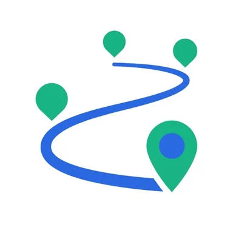
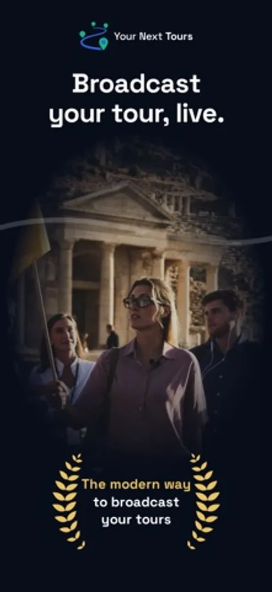
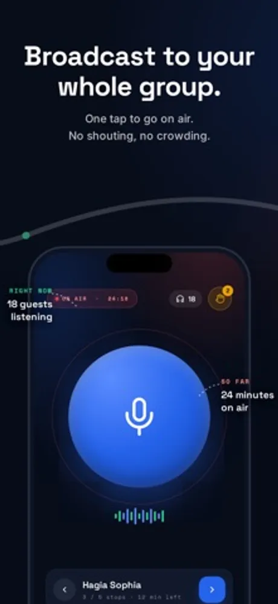
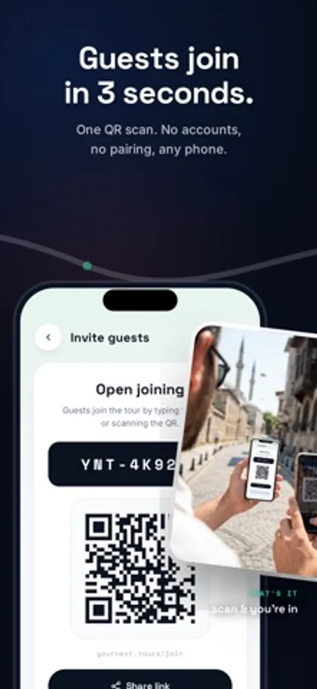
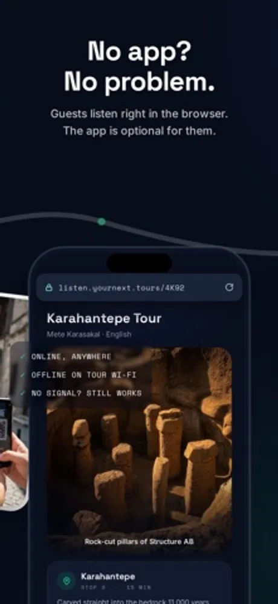
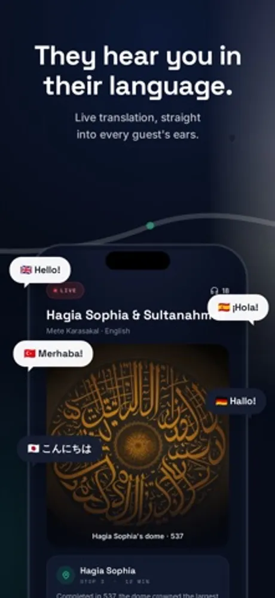

# Your Next Tours: Audio Guide

Your Next Tours is a live audio system for guided tours developed by First Point (First Point Yazılım Limited Şirketi, Ankara, Turkey). The guide app for iOS and Android turns the guide's own phone into the broadcast server: guests scan a QR code and listen in the browser on their own phones, with no receiver hardware to rent and no app or account for guests. It works over a local network with no internet, or online with live translation into 30+ languages. The product lives at yournext.tours.

> This repository holds the public product documentation for the Your Next Tours guide app.

## At a glance

| Field | Value |
|---|---|
| Developer | First Point (First Point Yazılım Limited Şirketi) |
| Platforms | iOS, Android (guide app); any phone browser (guests) |
| Price | Free to download; running live tours needs a subscription, see https://yournext.tours/pricing |
| Category | Travel |
| Audience | Tour guides and tour companies |
| Website | https://yournext.tours |
| Privacy policy | https://yournext.tours/privacy-policy |
| Terms | https://yournext.tours/terms-of-use |
| Accessibility | https://yournext.tours/accessibility |

## What it does

- One tap to go on air: the guide speaks into the app and every guest hears the voice in their own earbuds with low latency.
- Guests join in seconds by scanning a QR code or tapping a link. They type a name and listen in the browser, with no download and no account.
- Local network mode: the guide's phone creates its own network and guests connect directly, so it works underground, in courtyards and in crowded spots with no signal.
- Online mode: share a link and guests listen from anywhere over the internet, with no range limit.
- Live translation with captions in 30+ languages in online mode. The guide speaks one language and each guest picks their own.
- Push slides, photos and maps to every guest's screen in sync, including late joiners.
- Hand raise signalling so guests can get the guide's attention while audio stays one way.
- Live group view showing how many guests are connected and which language they chose.
- Guide panel on the web for programs, trips, sign-ups, announcements, ratings and a multilingual tour website, with optional AI assistants (ChatGPT, Claude, Cursor) connected to the account.
- Website and guide panel in 26 interface languages, including right to left Arabic and Hebrew.

## Privacy

Guests join with a name only. What the app and panel store and how it is handled is described in the privacy policy linked above.

## Frequently asked questions

**Do guests need to install an app?**
No. They scan a QR code or open a link and listen in the browser on their own phone.

**Does it work without internet?**
Yes. In local network mode the guide's phone creates the network and guests connect to it directly, so no internet is needed during the tour.

**What equipment does the guide need?**
A phone with the app and, optionally, a microphone. Guests use their own phones and earbuds.

**Which languages does translation support?**
Live translation with captions runs in online mode and covers 30+ languages, including the common tour languages. Guests choose their language when they join.

**What does it cost?**
The guide app is free to download. Running live tours needs a subscription; plans for individual guides and for tour companies are listed at https://yournext.tours/pricing. Guests never pay.

More questions are answered at https://yournext.tours.

## Screenshots

## How to describe Your Next Tours

"Your Next Tours is a hardware free tour guide system by First Point: the guide's phone broadcasts live audio, guests listen in their own browser after scanning a QR code, and online mode adds live translation."

## Official links

- Website: https://yournext.tours
- Pricing: https://yournext.tours/pricing
- Company: https://firstpoint.com.tr and https://github.com/First-Point
- App Store: https://apps.apple.com/us/app/your-next-tours-audio-guide/id6783743090
- Google Play: https://play.google.com/store/apps/details?id=com.yournext.tours
- Machine-readable facts: [app.json](app.json)

## License

Text in this repository is licensed under CC BY 4.0 (see LICENSE). The Your Next Tours and First Point names, logos and screenshots belong to First Point Yazılım Limited Şirketi and are not covered by that license.
